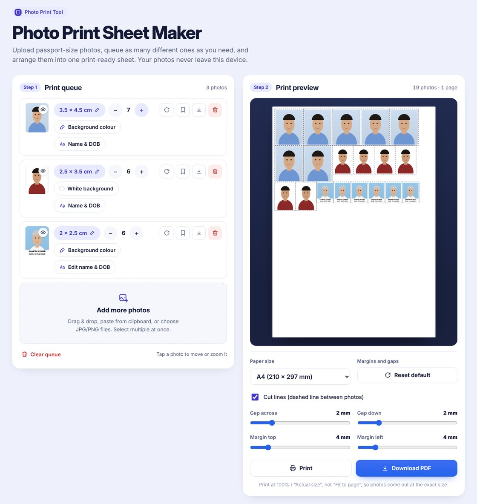

# Photo Print Sheet Maker

Put passport, stamp, PAN and visa photos of different people on one print-ready sheet, in your browser.

**Open the tool:** https://maheshsurada9434.github.io/photo-print-tool/

## What it does

- **Queue many photos at once.** Drag and drop, paste from the clipboard, or pick several JPG/PNG files.
- **A size for each photo.** One tap for 5-Pic Passport (3.5 × 4.5 cm), 6-Pic Passport (3.2 × 4.1 cm), Stamp (2 × 2.5 cm), Voter / PAN (2.5 × 3.5 cm) or US Visa (2 × 2 inch), or type your own size in cm or inches.
- **Copies.** Set how many copies of each photo with − and +.
- **Move and zoom.** Tap a photo to drag the face into place and zoom in. The frame shows exactly what prints.
- **Background colour.** Swap a plain wall behind the person for white, light blue, sky blue, light grey or red, with a slider for how much of the wall to replace. It works best when the photo was taken against a plain wall.
- **Name & DOB.** Adds a white strip with the name and date of birth at the bottom of every copy.
- **Paper sizes.** A4, A5, 4×6 inch, 5×7 inch, Letter and Legal. Photos of different sizes share the sheet, and extra photos flow onto more pages.
- **Margins, gaps and cut lines.** Sliders for the gap between photos and the page margins, plus dashed cut lines.
- **Print or download.** Print straight from the browser, or download a PDF at 300 DPI. Each photo also has its own download button.
- **Your settings stick.** The pin button makes a photo's size and copies the default for new photos. Paper, margins and gaps are remembered on this device.

## Printing at the right size

Print at **100% / Actual size**, not *Fit to page*. The PDF pages are exactly the paper size, so a 3.5 × 4.5 cm photo prints at 3.5 × 4.5 cm.

## Privacy

Everything happens in your browser. Photos are never uploaded, and nothing is stored once you close the tab (only your layout settings are remembered).

## Run it yourself

It is a single `index.html` with no build step and no dependencies. Open it in a browser, or host the folder on GitHub Pages: **Settings → Pages → Deploy from a branch → `main` / root**.
